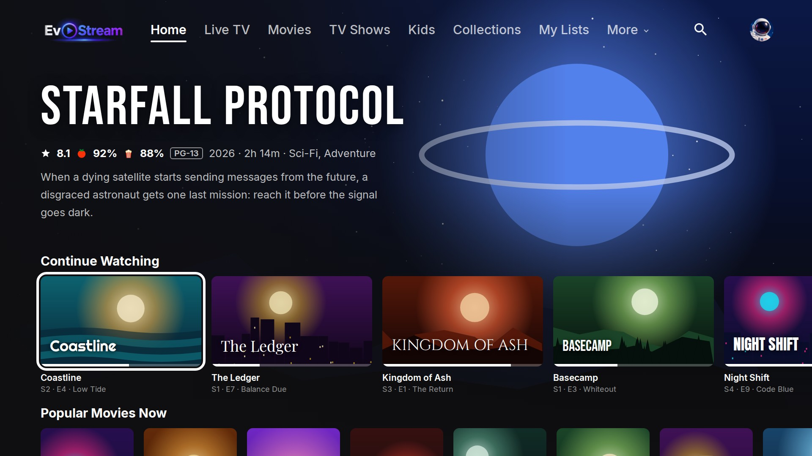

# EvoStream

**A Jellyfin companion app for personal media collections.**

EvoStream lets you watch the movies, shows, audiobooks and live TV on your own Jellyfin media server, on your TV. It comes with no content; you sign in to a server you or your household run.

- Website: https://arjohnson15.github.io/evostream-app/
- Privacy policy: https://arjohnson15.github.io/evostream-app/privacy.html
- Terms of use: https://arjohnson15.github.io/evostream-app/terms.html
- Support: [open an issue](https://github.com/arjohnson15/evostream-app/issues)

Platforms: Roku (beta); Android TV, Fire TV and phones in development.

*Titles and artwork in the screenshots are made up for illustration.* EvoStream is an independent app, not affiliated with or endorsed by the Jellyfin project or Roku, Inc.
